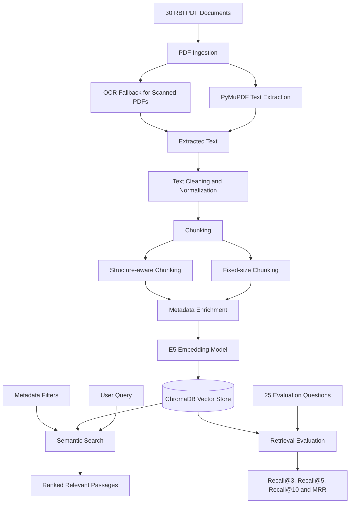

# PolicyLens – System Architecture

## Document Ingestion Pipeline

## Evaluation Results

| Metric | Structure-aware | Fixed-size |
|---|---:|---:|
| Recall@3 | 88% | 72% |
| Recall@5 | 96% | 84% |
| Recall@10 | 100% | 92% |
| MRR | 0.7743 | 0.7613 |

**Preferred strategy:** Structure-aware chunking performed better overall on the 25-question evaluation dataset.
